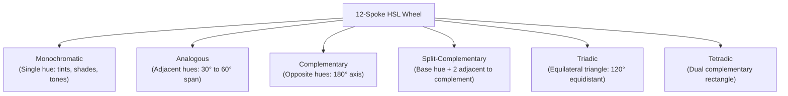
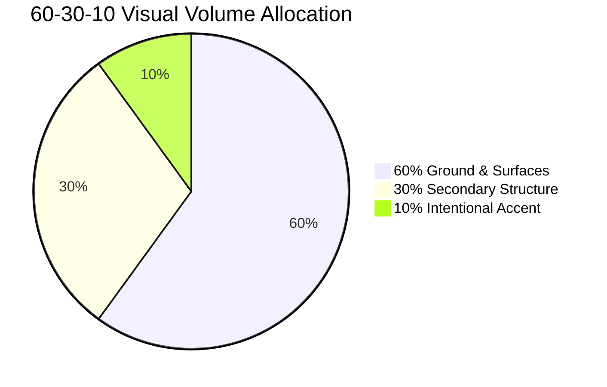

# Color Theory, Harmonies & Accessible Systems

This guide provides the foundational rules, optical physics, and systematic token models for building high-craft, accessible color palettes in digital product interfaces.

---

## 1. Classical Geometric Harmonies in UI

Color harmony is rooted in geometric relationships across the 12-spoke HSL color wheel. When constructing an interface palette, select an intentional harmony model rather than sampling random hex codes.



### 1.1 Monochromatic Harmony
- **Definition**: A single base hue varied exclusively across lightness and saturation.
- **UI Context**: High-density data consoles, fintech dashboards, technical developer tools, and disciplined Swiss minimalist interfaces.
- **Strengths**: Eliminates color discord, maximizes focus on typography and data density.
- **Trap to Avoid**: Low contrast between interactive states and static panels. Always enforce at least 25% lightness separation between interactive hover states and surface grounds.

### 1.2 Analogous Harmony
- **Definition**: Two to three adjacent hues spanning 30 to 60 degrees (for example, Emerald `#059669` to Teal `#0D9488` to Cyan `#0891B2`).
- **UI Context**: Wellness, nature, environmental technology, calming productivity applications.
- **Strengths**: Organic visual comfort with minimal optical strain.
- **Rule**: Pick one dominant anchor hue for primary surfaces and actions; use the adjacent hues exclusively for metadata tags or subtle categorical states.

### 1.3 Complementary Harmony
- **Definition**: Two opposing hues separated by 180 degrees (for example, Deep Indigo `#1E1B4B` and Warm Ochre `#D97706`).
- **UI Context**: Consumer applications, conversion-driven SaaS hero sections, high-stakes status indicators.
- **Strengths**: Creates maximum optical contrast and instant focal points.
- **Rule**: Never use complementary colors in equal 50/50 visual volume. The canvas ground must claim 90% of the surface area, with the complement restricted to conversion triggers (the 60-30-10 rule).

### 1.4 Split-Complementary Harmony
- **Definition**: A base hue paired with the two colors adjacent to its complement (for example, Midnight Navy `#0F172A` paired with Soft Coral `#F43F5E` and Warm Amber `#F59E0B`).
- **UI Context**: Multi-faceted creative platforms, e-commerce storefronts, editorial publishing.
- **Strengths**: Delivers high visual energy with less optical tension than direct complementary pairs.

### 1.5 Triadic & Tetradic Harmonies
- **Definition**: Three (triadic) or four (tetradic) equidistant hues.
- **UI Context**: Complex design systems with multi-category status requirements (success, warning, error, info).
- **Rule of Restraint**: Subordinate all but one hue. A single dominant hue governs brand presence; secondary hues are muted to pastel or low-chroma tones for categorical chips only.

---

## 2. The 60-30-10 Spatial Volume Rule

In UI design, colors must not compete equally for the user's attention. Apply the classic interior architecture ratio to digital viewports:



1. **60% Dominant Ground Tone**:
   - Background canvas, ambient surfaces, and primary negative space.
   - Sets the emotional temperature of the application (deep slate, warm chalk, crisp cool gray).
   - CSS token: `--surface-ground`, `--surface-base`.

2. **30% Secondary Structure**:
   - Card panels, table borders, navigation bars, modal dialogs, and muted body typography.
   - Provides structural scaffolding without claiming visual focus.
   - CSS token: `--surface-card`, `--border-subtle`, `--text-secondary`.

3. **10% Intentional Accent**:
   - Primary call-to-action buttons, active navigation markers, key performance metrics, focus rings.
   - If an entire screen feels saturated, the accent ratio has exceeded 10%.
   - CSS token: `--accent-primary`, `--accent-focus`, `--status-active`.

---

## 3. Optical Halation & Dark Mode Physics

### 3.1 Preventing Retinal Halation
Never set pure `#000000` pitch black against pure `#FFFFFF` white in dark mode. 
- **The Science**: The high luminance contrast causes optical halation, where white letterforms blur and bleed onto dark photoreceptors, causing eye fatigue.
- **Solution**: Tint dark grounds with 3% to 6% blue, slate, or charcoal chroma:
  - Deep Slate Ground: `#0B0D11` or `#0F172A`
  - Obsidian Minimal Ground: `#111114` or `#121216`
  - Warm Charcoal Ground: `#161614` or `#18181B`
- Set primary text to off-white (`#F8FAFC`, `#F3F4F6`, `#E2E8F0`) rather than `#FFFFFF`.

### 3.2 Surface Elevation in Dark Themes
In physical light, objects closer to the light source are brighter. In dark interfaces, higher z-index surfaces should be slightly lighter in tone, accompanied by crisp 1px borders rather than blurry black drop shadows:

| Elevation Level | Token Name | Approximate Tone | Purpose |
| :--- | :--- | :--- | :--- |
| **Level 0 (Canvas)** | `--surface-ground` | `#0B0D11` | Root page background |
| **Level 1 (Panels)** | `--surface-card` | `#13161F` | Standard bento cards, table rows |
| **Level 2 (Dropdowns)** | `--surface-overlay` | `#1A1E2B` | Menus, popovers, hover cards |
| **Level 3 (Modals)** | `--surface-dialog` | `#22283A` | Dialogs, command palettes |

---

## 4. Color Psychology Across Product Archetypes

Colors carry cultural, optical, and psychological affordances. Choose the ground and accent based on the product domain:

| Domain | Recommended Base | Recommended Accent | Psychological Impact |
| :--- | :--- | :--- | :--- |
| **Developer Tools & Infrastructure** | Obsidian Slate (`#0D1117`) | Terminal Emerald (`#10B981`) or Cyan (`#06B6D4`) | Precision, low latency, calm focus |
| **Fintech & Asset Management** | Deep Navy (`#0A0F1D`) | Royal Sapphire (`#2563EB`) or Warm Gold (`#D97706`) | Security, institutional trust, stability |
| **Creative Tools & WebGL** | Dark Neutral (`#121214`) | Electric Violet (`#8B5CF6`) or Amber (`#F59E0B`) | Unconventional creativity, high agency |
| **Editorial & Publishing** | Warm Paper (`#FBFAF7`) | Ink Black (`#191919`) + Crimson Accent (`#BE123C`) | Historical authority, reader comfort |
| **Health & Bio-Engineering** | Clinical White (`#F8FAFC`) | Sage Green (`#059669`) or Ocean Teal (`#0D9488`) | Purity, vitality, scientific rigor |

---

## 5. Semantic Design Token Schema

Define palettes in CSS custom properties using semantic tokens rather than raw hex values or color names:

```css
:root {
  /* Surface elevations */
  --surface-ground: #0b0d11;
  --surface-panel: #13161f;
  --surface-elevated: #1a1e2b;
  --surface-overlay: #22283a;

  /* Text hierarchies */
  --text-primary: #f8fafc;    /* Contrast > 12:1 */
  --text-secondary: #94a3b8;  /* Contrast > 5.5:1 */
  --text-muted: #64748b;      /* Contrast > 4.5:1 */

  /* Structural boundaries */
  --border-subtle: rgba(255, 255, 255, 0.08);
  --border-strong: rgba(255, 255, 255, 0.16);
  --border-focus: #3b82f6;

  /* Intentional accents */
  --accent-primary: #3b82f6;
  --accent-hover: #2563eb;
  --accent-contrast: #ffffff;

  /* Functional status */
  --status-success: #10b981;
  --status-warning: #f59e0b;
  --status-error: #ef4444;
}
```

---

## 6. Pre-Flight Contrast Audit Matrix

Before approving a frontend interface, verify every text element meets WCAG AA standards:

1. **Heading on Canvas**: Verify `--text-primary` against `--surface-ground` (target >= 7:1).
2. **Body on Card**: Verify `--text-secondary` against `--surface-panel` (target >= 4.5:1).
3. **Muted Label on Card**: Verify `--text-muted` against `--surface-panel` (minimum 4.5:1 for regular text).
4. **Button Label**: Verify `--accent-contrast` against `--accent-primary` (minimum 4.5:1).
5. **Form Field Border**: Verify `--border-strong` against `--surface-panel` (minimum 3:1 for graphical boundary).
6. **Focus Ring**: Verify `--border-focus` against both the button and adjacent canvas.
